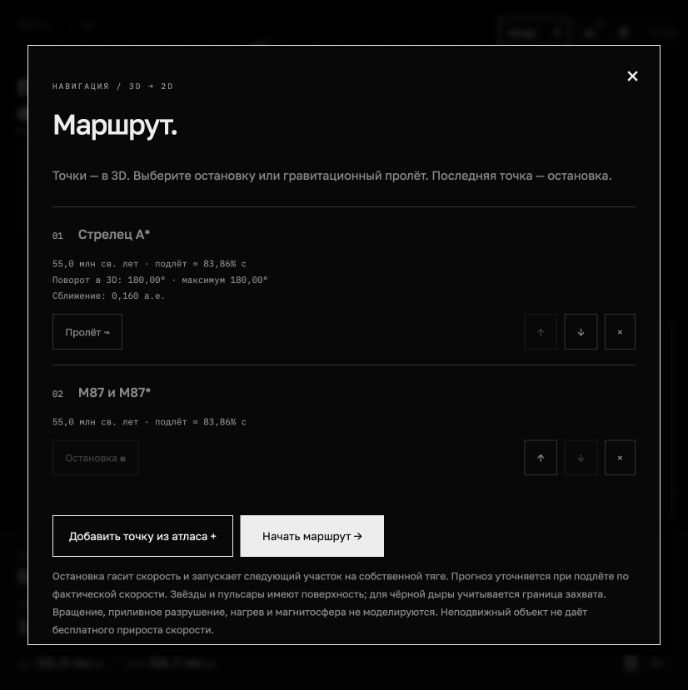

# ПАРУС · Атлас Вселенной

Монохромная браузерная 2D-игра о межзвёздном путешествии: фотонная тяга, парус на потоке звёздного взрыва, магнитное торможение и гравитационные пролёты.

[Открыть опубликованную игру](https://parus-universe.yellowutka.chatgpt.site/) (вход через ChatGPT).

## Запуск локально

Нужен Python 3; установка библиотек и сборка не требуются:

```sh
python3 -m http.server 8765 --directory dist
```

Откройте <http://localhost:8765>. Игра работает на HTML, CSS, JavaScript и Canvas; шрифты и данные включены в репозиторий. Прогресс и тема сохраняются в localStorage браузера.

## Управление

- Колесо мыши — масштаб, перетаскивание — обзор.
- «Атлас» — поиск звезды, галактики или другого объекта.
- ⌁ — маршрут до 12 точек, остановки и гравитационные пролёты.
- ↗ в карточке цели — характеристики и источники.
- Пробел — пауза; 1× / 5× / 20× — темп симуляции.
- ☼ — светлая или тёмная тема; ··· — справка, физика, источники, новая экспедиция.

## Модель

- Сухая масса корабля — 1 т, запас рабочего вещества учитывается отдельно.
- Фотонный двигатель постепенно превращает вещество в направленное излучение; скорость, путь и часы вычисляются по релятивистскому ракетному уравнению.
- Идеальный звёздный парус: поток ослабевает как 1/r² с релятивистской поправкой.
- Магнитная ловушка передаёт импульс встречных частиц и сохраняет собранную массу; остаточную скорость гасит обратная фотонная тяга.
- Локальные гравитационные пролёты — геодезические Шварцшильда. Планировщик проверяет требуемый угол в 3D и границу захвата; недоступный поворот блокируется.
- Часы «борт / Земля» учитывают специальную теорию относительности и гравитационное замедление во время пролёта.

Это научно мотивированная игровая модель: движения объектов, расширение Вселенной во время полёта, вращение чёрных дыр, нагрев, приливное разрушение и многотельные взаимодействия не интегрируются. Остановка — условная стоянка в системе, а не расчёт посадки или устойчивой орбиты. Параметры фантастического взрыва заданы игрой. Для пульсаров типовые масса и радиус явно подписаны как модельные.

Подробные формулы: [docs/physics.md](docs/physics.md).

## Атлас и проекция

575 объектов: исходный набор известных объектов и выборки HYG 4.1, OpenNGC, ATNF 2.9.0 после исключения повторов. Для доступных RA/Dec и расстояний строится полная 3D-позиция в галактической системе. Карта показывает ортографическую проекцию Xg / Yg; Zg сохраняется в расчётах расстояний и углов. Схематические ориентиры без однозначных координат не допускаются в физические маршруты.

Происхождение, формулы пересчёта и контрольные суммы: [dist/catalog-sources.json](dist/catalog-sources.json). Инструкция обработки каталогов: [data-tools/README.md](data-tools/README.md).

## Проверки

Нужен Node.js 18 или новее:

```sh
node verify.mjs
```

Проверяются ракетное уравнение, разгон паруса, магнитный захват, тормозной путь, остановка, часы, 3D-геометрия, рассеяние и захват в метрике Шварцшильда, невозможные маршруты, пролёт без остановки, многоэтапный маршрут и восстановление сохранений.

## Структура

- `dist/` — готовая статическая игра, исходники JS/CSS и локальные шрифты.
- `verify.mjs` — проверки физики и логики без браузерных зависимостей.
- `data-tools/` — генератор выборки и небольшие координатные таблицы.
- `docs/` — описание физики и снимок интерфейса.

## Сторонние данные и шрифты

Выборки HYG / OpenNGC распространяются по CC BY-SA 4.0; атрибуция и изменения перечислены в [THIRD_PARTY_NOTICES.md](THIRD_PARTY_NOTICES.md). Шрифты Golos Text и IBM Plex Mono — SIL Open Font License; тексты лицензий находятся в `dist/fonts/`.


