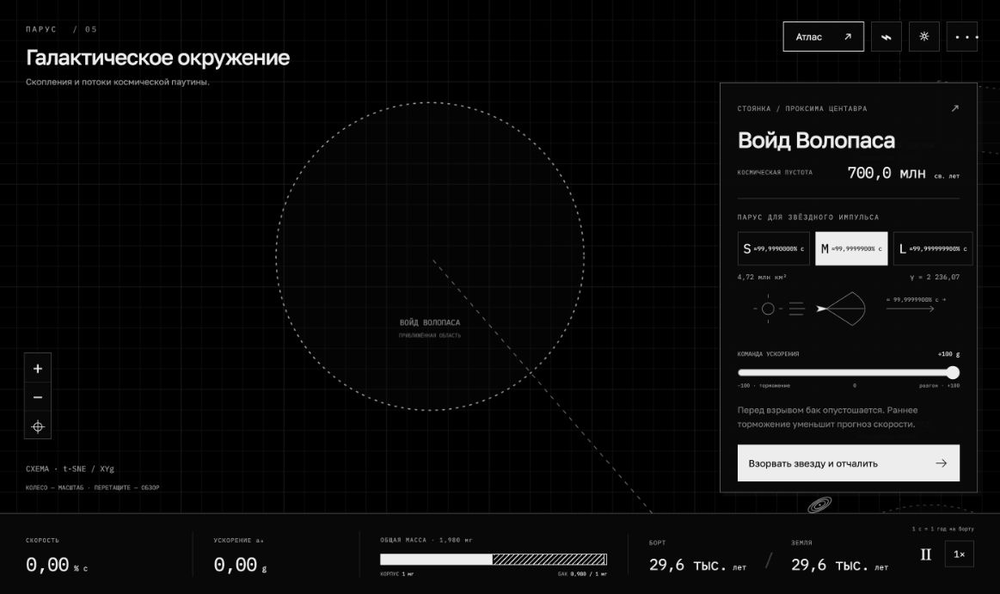

# ПАРУС · Атлас Вселенной

Монохромная браузерная 2D-игра о межзвёздном путешествии: фотонная тяга, парус на потоке звёздного взрыва, торможение парусом и гравитационные пролёты.

Игра запускается локально. [Инструкция для следующего агента](README-AGENT.md).

## Запуск локально

Нужен Python 3; установка библиотек и сборка не требуются:

```sh
python3 -m http.server 8765 --bind 127.0.0.1 --directory dist
```

Откройте <http://127.0.0.1:8765>. Игра работает на HTML, CSS, JavaScript и Canvas; шрифты и данные включены в репозиторий. Прогресс и тема сохраняются в localStorage браузера.

## Управление

- Колесо мыши — масштаб, перетаскивание — обзор.
- «Атлас» — поиск звезды, галактики или другого объекта.
- ⌁ — маршрут до 12 точек, остановки у объектов и гравитационные повороты у чёрных дыр.
- ↗ в карточке цели — характеристики и источники.
- Пробел — пауза; 1× / 10× / 100× / 1000× — темп симуляции.
- ☼ — светлая или тёмная тема; ··· — справка, физика, источники, новая экспедиция.

Базовый темп 1×: секунда игрока равна бортовому году, включая стоянку. Короткие разгоны и торможения показываются замедленно с явным коэффициентом рядом с часами; автоматика никогда не превышает выбранный игроком темп, физические времена и путь остаются согласованы. Земные часы следуют физической траектории. При 10×/100×/1000× это 10/100/1000 бортовых лет в секунду. Пауза останавливает оба времени, в том числе на стоянке.

## Модель

- Сухая масса корабля — 1 мг, бак — до 1 мг, начальная заправка полная (общая масса 2 мг). Одна полоска показывает корпус / топливо / свободное место: 50% / 50% / 0%. Перед каждым звёздным взрывом бак опустошается, разгон начинается с массой 1 мг.
- Пассивная полоска −100…+100 g рядом со скоростью показывает фактическое ускорение. Автопилот раскрывает и складывает паруса, переключает тягу и торможение; ручных команд нет.
- Фотонный двигатель постепенно превращает вещество в направленное излучение; скорость, путь и часы вычисляются по релятивистскому ракетному уравнению.
- Идеальный световой парус ловит фотонную вспышку звёздного взрыва: поток ослабевает как 1/r² с доплеровской поправкой и конечной длительностью. Парус постепенно раскрывается с пределом 100 g. Номиналы S/M/L — 99% / 99,99999% / 99,9999999% c при пустом баке; на коротком маршруте торможение начинается раньше. Складывание автоматическое; номинальная скорость является событием остановки разгона, а не присваивается кораблю. Воспроизведение: `node data-tools/calibrate-sails.mjs`.
- Тот же парус передаёт импульс встречных частиц и сохраняет собранную массу до заполнения бака. Затем частицы охлаждаются и выпускаются в системе корабля; торможение продолжается при постоянной массе; остаточную скорость гасит обратная фотонная тяга.
- Локальные гравитационные пролёты доступны только у чёрных дыр (Лебедь X-1, Стрелец A*, M87*) — геодезические Шварцшильда. Планировщик проверяет требуемый угол в 3D и границу захвата; недоступный поворот блокируется.
- Часы «борт / Земля» учитывают специальную теорию относительности и гравитационное замедление во время пролёта.

Это научно мотивированная игровая модель: движения объектов, расширение Вселенной во время полёта, вращение чёрных дыр, нагрев, приливное разрушение и многотельные взаимодействия не интегрируются. Остановка — условная стоянка в системе, а не расчёт посадки или устойчивой орбиты. Параметры фантастического взрыва заданы игрой. Масса и прочность огромного миллиграммового паруса идеализированы. В многоэтапном маршруте после остановки у неиспользованной звезды начинается разгон парусом. Пульсары доступны для остановки, но не для гравитационного поворота.

Состав каталога и правила отображения: [docs/catalog.md](docs/catalog.md). Обновлять вместе с данными и правилами.

Подробные формулы: [docs/physics.md](docs/physics.md).

## Атлас и проекция

138 198 каталожных записи: полные локальные снимки HYG 4.1 (119 626 строк), OpenNGC (13 970) и ATNF 2.9.0 (4503), все 652 имени IAU WGSN и исходные космические ориентиры. Каталоги пересекаются; исходные известные объекты объединены с их записями. Пространственные участки подгружаются по области и масштабу, общий поисковый индекс загружается при первом поиске в отдельном потоке. На дальнем масштабе видны реальные представители участков; при приближении доступны все точки. Фоновые звёзды — приглушённые точки без постоянных подписей; они не вытесняют известные звёзды. В пределах 50 световых лет выделены до 100 известных звёзд, все 110 обозначений Мессье доступны и имеют отдельный приоритет.

Объекты без известного расстояния, исторические NonEx/Dup и звёзды с относительной ошибкой параллакса более 50% остаются в поиске атласа, но исключаются из пространственных тайлов и карты. Искусственных радиальных оболочек нет. Приблизительные модельные расстояния ATNF и расстояния по красному смещению отмечены отдельно; по ним можно летать. Мегаструктуры — стены, войды, кольца и дуги — сохранены вместе с контурами. Для протяжённой структуры точка прибытия является явно обозначенным игровым ориентиром, а не измеренным компактным центром. Эллипсы связывают 461 каталожную группу; размеры и ориентация схем условны. У Альфы Центавра показана иерархия AB–C.

В Андромеде добавлены реальные V1 Хаббла и AF Андромеды, в Большом Магеллановом Облаке — R136a1, в Малом — HD 5980. Их направления измерены; расстояния приняты по принадлежности галактике, индивидуальная глубина неизвестна. У любого объекта карты можно найти звезду для следующего разгона: известную рядом либо явно обозначенную игровую звезду.

Для объектов с расстоянием строится полная 3D-позиция. Физика использует исходное 3D; старые точки сохраняют t-SNE-раскладку, дополнительные получают детерминированное продолжение поля смещений. Физические координаты от отображения не зависят.

Происхождение, формулы пересчёта и контрольные суммы: [dist/catalog-sources.json](dist/catalog-sources.json). Инструкция обработки каталогов: [data-tools/README.md](data-tools/README.md).

Каждый участок отображается прямой между закреплёнными точками раскладки. Положение корабля и отметок линейно зависит от доли реального 3D-пути; промежуточные положения не проходят повторно через t-SNE.

Отметки конца разгона, магнитного и точного торможения сохраняются до конца текущего участка. Камера при старте не меняется, если обе точки уже видны; иначе отдаляется с запасом, без автоматического приближения.

## Проверки

Нужен Node.js 18 или новее:

```sh
node verify.mjs
```

Проверяются ракетное уравнение, разгон паруса, магнитный захват, тормозной путь, остановка, единый ход бортового времени и перенос остатка кадра между этапами, 3D-геометрия, рассеяние и захват в метрике Шварцшильда, невозможные маршруты, пролёт без остановки, многоэтапный маршрут и восстановление сохранений.

## Структура

- `dist/` — готовая статическая игра, исходники JS/CSS и локальные шрифты.
- `verify.mjs` — проверки физики и логики без браузерных зависимостей.
- `data-tools/` — генератор выборки и небольшие координатные таблицы.
- `docs/` — описание физики и снимок интерфейса.

## Сторонние данные и шрифты

Выборки HYG / OpenNGC распространяются по CC BY-SA 4.0; атрибуция и изменения перечислены в [THIRD_PARTY_NOTICES.md](THIRD_PARTY_NOTICES.md). Шрифты Golos Text и IBM Plex Mono — SIL Open Font License; тексты лицензий находятся в `dist/fonts/`.





## Полный каталог: воспроизведение и проверка

Сохраните исходные `hyg_v41.csv`, `NGC.csv`, `iau-names.html`, `psrcat.db` в `data-tools/raw/`. Эта папка исключена из Git; готовые браузерные данные `dist/catalog-data/` включены в репозиторий.

```sh
python3 data-tools/build-full-catalog.py
node verify-stream.mjs
node verify-map.mjs
node verify.mjs
```

На диске пространственные данные занимают около 80 МБ, поисковый индекс — около 17 МБ из них. Браузер загружает только нужные участки; поиск хранит компактный индекс в Web Worker. Обычный запуск через локальный HTTP-сервер предпочтителен. Однофайловый экспорт через `build-standalone.py` включает все данные внутрь HTML для `file://`, поэтому он значительно больше и потребляет больше памяти; внешних запросов ему не требуется.
