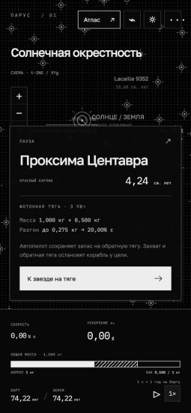
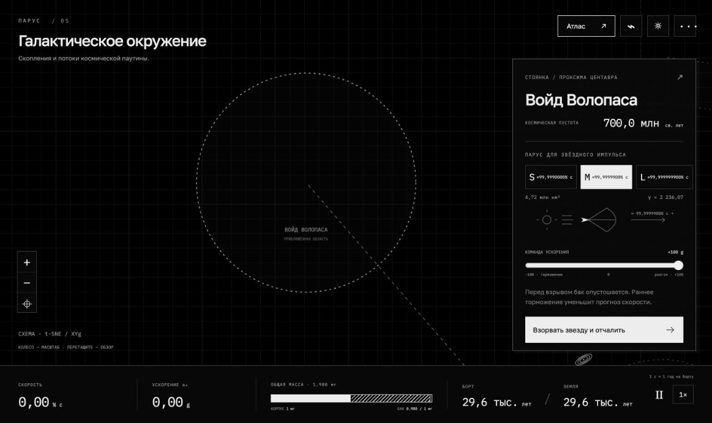

# КОВЧЕГ · Атлас Вселенной

Браузерная 2D-игра о межзвёздном путешествии корабля «Ковчег»: фотонная тяга, парус на постоянном свете или вспышке, совместное торможение парусом и двигателем и гравитационные пролёты.

Игра запускается локально. [Инструкция для следующего агента](README-AGENT.md).

На масштабе Вселенной видны точечные области космического рассвета, тёмных веков и реликтового света. Сведения открываются в обычной карточке цели. Далёкий каталог дополнен кандидатами CCPC-II и спектроскопическими целями JADES; [источники, границы эпох и ограничения](docs/universe-overview.md).

## Запуск локально

Нужен Python 3.9 или новее. После скачивания репозитория один раз установите
проверенную версию каталогов из отдельного архива GitHub Releases:

```sh
python3 data-tools/catalog-artifacts.py install
```

Затем запустите локальный сервер:

```sh
python3 -m http.server 8765 --bind 127.0.0.1 --directory dist
```

Откройте <http://127.0.0.1:8765>. Игра работает на HTML, CSS, JavaScript и Canvas;
шрифты включены в репозиторий. Каталоги после установки хранятся локально;
повторная установка той же версии не скачивает архив заново. Прогресс и тема
сохраняются в localStorage браузера. [Архивы, проверка и установка без сети](docs/catalog-artifacts.md).

## Управление

- Колесо мыши — масштаб, перетаскивание — обзор.
- «Поиск» — поиск звезды, галактики или другого объекта. «Фильтры» — классы объектов, подборки и каталоги с множественным выбором. В «Подборках» есть «Красивые снимки»: объекты с фотографиями обсерваторий, без карт и обзорных полей DSS. Галерея включает Hubble, Webb, ESO и другие архивы AstroPix, а также 12 000 цветных фотографий отдельных галактик Siena Galaxy Atlas / DESI Legacy Imaging Surveys; снимки загружаются по внешним ссылкам при просмотре.
- ⌁ — маршрут до 12 точек, остановки у объектов и гравитационные повороты у чёрных дыр.
- ↗ в карточке цели — характеристики и источники.
- Пробел — пауза; 0,5× / 1× / 10× / 100× / 1000× — темп симуляции.
- ☼ — девять тем: чёрная, белая, Blueprint, Радар, Янтарь, Monokai, Dracula, Nord, Solarized.
- Маршрут поддерживает до 10 будущих участков. Shift добавляет точки, двойной клик добавляет конечную и запускает полёт; в полёте оба действия добавляют следующие участки. После выбора гравитационного манёвра выберите другой объект на карте или через поиск и подтвердите кнопкой «Добавить точку».
- «Как летим» — переключатели тяги, паруса, коллектора и сверхновой; под ними — длительность полёта. Запас по умолчанию — 50% бака, его настройка и полный расчёт — в «Подробном плане».
- ··· → «Настройки» → «Мультиплеер» включает корабли-боты без следов. Щелчок по кораблю — скорость и относительные часы.
- ··· → «Бортовая библиотека» — как летать, журнал экспедиции, физика, [расчёт разгона от пульсаров](dist/pulsar-research.md) и источники. «Новая экспедиция» остаётся в основном меню.

Базовый темп 1×: секунда игрока равна бортовому году, включая стоянку. Автоматического замедления нет: все фазы полёта идут в выбранном игроком темпе, физические времена и путь остаются согласованы. Земные часы следуют физической траектории. При 0,5× это половина бортового года в секунду; при 10×/100×/1000× — 10/100/1000 бортовых лет в секунду. Пауза останавливает оба времени, в том числе на стоянке.

## Модель

- Сухая масса корабля — 1 кг, включая парус Si₃N₄ Ø 100 м массой 0,785 кг. Бак — 1 кг, изначально полный (общая масса 2 кг). При разгоне светом топливо сохраняется и участвует в инерционной массе.
- Пассивная полоска −100…+100 g рядом со скоростью показывает фактическое ускорение. Автопилот раскрывает и складывает паруса, переключает тягу и торможение; ручных команд нет.
- Фотонный двигатель постепенно превращает вещество в направленное излучение; скорость, путь и часы вычисляются по релятивистскому ракетному уравнению.
- Три режима: собственная фотонная тяга; постоянный свет звезды через зеркало Ø 1 км; звёздная вспышка через то же зеркало. Светимость берётся из болометрических данных, при отсутствии — помеченная оценка по типу. Постоянный свет не ограничен 30 сутками, вспышка ограничена. Доплеровское ослабление и запаздывание света сохранены. Звезда уничтожается только при вспышке.
- Парус и обратная фотонная тяга тормозят совместно, собирая и расходуя вещество без обязательного остатка бака; прогноз показывает топливо при прибытии. Суммарная перегрузка до 100 g. Среда выбирается у цели; только цель-войд получает разреженную межгалактическую среду.
- Локальные гравитационные пролёты доступны только у чёрных дыр (Лебедь X-1, Стрелец A*, M87*) — геодезические Шварцшильда. Планировщик проверяет требуемый угол в 3D и границу захвата; недоступный поворот блокируется.
- Часы «борт / Земля» учитывают специальную теорию относительности и гравитационное замедление во время пролёта.

Это научно мотивированная игровая модель: движения объектов, расширение Вселенной во время полёта, вращение чёрных дыр, нагрев, приливное разрушение и многотельные взаимодействия не интегрируются. Остановка — условная стоянка в системе, а не расчёт посадки или устойчивой орбиты. Параметры фантастического взрыва заданы игрой. Масса и прочность огромного миллиграммового паруса идеализированы. В многоэтапном маршруте после остановки у неиспользованной звезды начинается разгон парусом. Пульсары доступны для остановки, но не для гравитационного поворота.

Состав каталога и правила отображения: [docs/catalog.md](docs/catalog.md). Обновлять вместе с данными и правилами.

Подробные формулы: [docs/physics.md](docs/physics.md).

## Атлас и проекция

138 198 каталожных записи: полные локальные снимки HYG 4.1 (119 626 строк), OpenNGC (13 970) и ATNF 2.9.0 (4503), все 652 имени IAU WGSN и исходные космические ориентиры. Каталоги пересекаются; исходные известные объекты объединены с их записями. Пространственные участки подгружаются по области и масштабу, общий поисковый индекс загружается при первом поиске в отдельном потоке. На дальнем масштабе видны реальные представители участков; при приближении доступны все точки. Фоновые звёзды — приглушённые точки без постоянных подписей; они не вытесняют известные звёзды. В пределах 50 световых лет выделены до 100 известных звёзд, все 110 обозначений Мессье доступны и имеют отдельный приоритет.

Объекты без известного расстояния, исторические NonEx/Dup и звёзды с относительной ошибкой параллакса более 50% остаются в поиске атласа, но исключаются из пространственных тайлов и карты. Искусственных радиальных оболочек нет. Приблизительные модельные расстояния ATNF и расстояния по красному смещению отмечены отдельно; по ним можно летать. Мегаструктуры — стены, войды, кольца и дуги — сохранены вместе с контурами. Для протяжённой структуры точка прибытия является явно обозначенным игровым ориентиром, а не измеренным компактным центром. Эллипсы связывают 461 каталожную группу; размеры и ориентация схем условны. У Альфы Центавра показана иерархия AB–C.

В Андромеде добавлены реальные V1 Хаббла и AF Андромеды, в Большом Магеллановом Облаке — R136a1, в Малом — HD 5980. Их направления измерены; расстояния приняты по принадлежности галактике, индивидуальная глубина неизвестна. При остановке у незвёздной цели выбирается известная звезда внутри её каталожной области, ближайшая к опорной точке; у точечной цели — звезда строго ближе 5 св. лет. Если подходящей звезды нет, только при прибытии появляется «Игровая звезда возле «название объекта»», доступная для следующего разгона. Shift + клик добавляет точки единого маршрута, начиная с выбранной цели (в новой игре — Альфы Центавра). Двойной клик добавляет конечную точку и запускает весь маршрут; без черновика сразу начинается прямой полёт. Во время полёта Shift и двойной клик добавляют следующие участки. Старт также доступен кнопкой карточки; повторный Shift по последней точке и Esc убирают один будущий участок. При добавлении через Shift чёрная дыра задаёт пролёт, которому нужна следующая точка. Внизу карточки чёрной дыры можно выбрать гравитационный манёвр или торможение.

Для объектов с расстоянием строится полная 3D-позиция. Физика использует исходное 3D; старые точки сохраняют t-SNE-раскладку, дополнительные получают детерминированное продолжение поля смещений. Физические координаты от отображения не зависят.

Происхождение, формулы пересчёта и контрольные суммы: [dist/catalog-sources.json](dist/catalog-sources.json). Инструкция обработки каталогов: [data-tools/README.md](data-tools/README.md).

Каждый участок отображается прямой между закреплёнными точками раскладки. Положение корабля и отметок линейно зависит от доли реального 3D-пути; промежуточные положения не проходят повторно через t-SNE.

Отметки конца разгона, магнитного и точного торможения сохраняются до конца текущего участка. Камера при старте не меняется, если обе точки уже видны; иначе отдаляется с запасом, без автоматического приближения.

## Проверки

Нужен Node.js 18 или новее:

```sh
node verify.mjs
```

Проверяются ракетное уравнение, разгон паруса, магнитный захват, тормозной путь, остановка, единый ход бортового времени и перенос остатка кадра между этапами, 3D-геометрия, рассеяние и захват в метрике Шварцшильда, невозможные маршруты, пролёт без остановки, многоэтапный маршрут и восстановление сохранений.

## Структура

- `dist/` — готовая статическая игра, исходники JS/CSS и локальные шрифты. Прикладной код разделён по ответственности; [схема модулей и цикл кадра](docs/runtime.md).
- `verify.mjs` — проверки физики и логики без браузерных зависимостей.
- `data-tools/` — генератор выборки и небольшие координатные таблицы.
- `docs/` — описание физики и снимок интерфейса.

## Сторонние данные и шрифты

Выборки HYG / OpenNGC распространяются по CC BY-SA 4.0; атрибуция и изменения перечислены в [THIRD_PARTY_NOTICES.md](THIRD_PARTY_NOTICES.md). Шрифты Golos Text и IBM Plex Mono — SIL Open Font License; тексты лицензий находятся в `dist/fonts/`.






## Полный каталог: воспроизведение и проверка

Сохраните исходные `hyg_v41.csv`, `NGC.csv`, `iau-names.html`, `psrcat.db` в `data-tools/raw/`.
Эта папка исключена из Git. Готовые поточные данные также исключены из Git;
их проверенная версия устанавливается из отдельного архива. Код генераторов,
небольшие исходные таблицы, атрибуция и контрольные суммы остаются в репозитории.

```sh
python3 data-tools/build-full-catalog.py
node verify-stream.mjs
node verify-map.mjs
node verify.mjs
```

Текущий набор потоковых данных для всех проекций занимает около 1,36 ГБ до
сжатия; точные размеры архива и распакованных файлов указаны в
`data-tools/catalog-artifact.json`. Браузер загружает только нужные участки;
поиск хранит компактный индекс в Web Worker. Однофайловый экспорт через
`build-standalone.py` требует предварительной установки каталогов и включает
данные внутрь HTML для `file://`; он значительно больше и потребляет больше памяти.

Телеметрия: масса слева, скорость по центру с логарифмической шкалой и равными интервалами 0 / 9% / 99% / 99,9% / … . Рядом показано относительное замедление бортовых часов в процентах. Ограничение торможения 1 g убрано; остаётся предел прочности 100 g.

Вспышка Солнца запрещена. У Солнца доступны собственная тяга и постоянный свет через зеркало.

В настройках доступны две проекции карты: обычная и радиальная; выбор запоминается. Обе используют каталожные 3D-позиции и не меняют физику. Прежний режим «Срез» удалён; сохранённое предпочтение `slice` при запуске заменяется обычной картой. Подробнее: [визуализация карты](docs/map-visualization.md).
